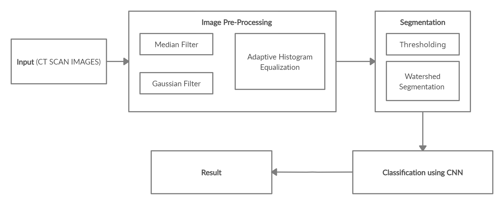
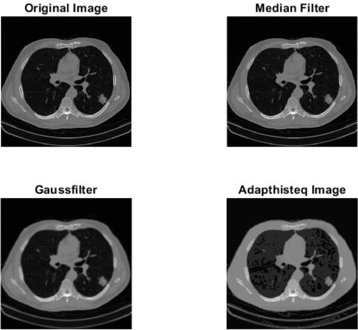
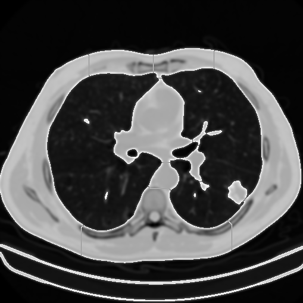
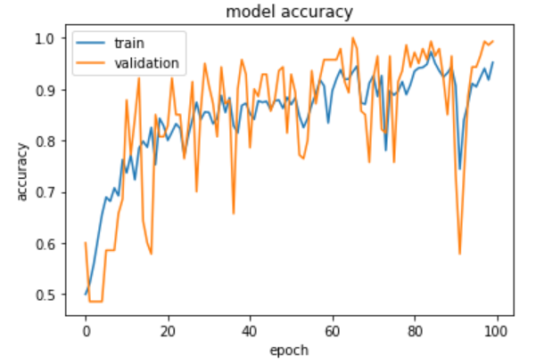
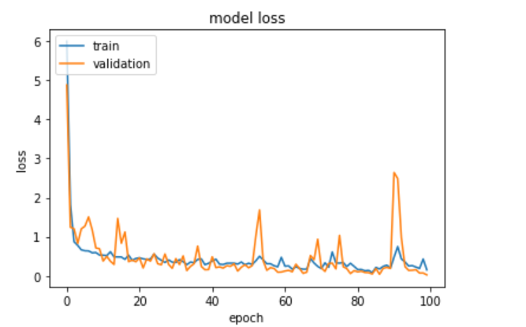

# Lung Cancer Detection & Classification Using Image Processing and a 12-Layer CNN

> **Official B.Tech Capstone Project** — Department of Electronics & Communication Engineering, **PES University, Bengaluru** (August 2020 – May 2021)  
> **Author & Maintainer:** Rajath Gadagkar (rajathgadagkar@gmail.com)  
> **Capstone Team:** Rajath Gadagkar (`PES1201700136`), Rhitesh Kumar Singh (`PES1201700254`), Dhruv K.C (`PES1201701265`), Nitin Kumar Pandit (`PES1201701837`)  
> **Project Guide:** Prof. H R Vanamala, Associate Professor, Dept. of ECE, PES University  
> **License:** [MIT](LICENSE)

## Overview

Early detection of pulmonary nodules on low-dose chest CT (LDCT) scans significantly improves lung cancer survival rates, yet manual radiological screening is time-intensive and vulnerable to acquisition noise. This project combines **classical medical image processing** (Median filtering, Gaussian smoothing, Adaptive Histogram Equalization, and marker-controlled Watershed segmentation) with a **custom 12-layer Convolutional Neural Network** trained on a **14× augmented CT corpus** to classify pulmonary scans as **Benign (0)** or **Malignant (1)**.

### Key Results

| Metric | Proposed 12-Layer CNN | Best Baseline (AlexNet) | Improvement |
|---|---:|---:|---:|
| **Test Accuracy** | **99.28%** | 89.99% | **+9.29%** |
| **Validation Loss** | **0.0235** | 0.9657 | **-97.6%** |
| **Precision (Class 0 / Class 1)** | **0.98 / 1.00** | 0.88 / 0.92 | +0.10 / +0.08 |
| **Recall (Class 0 / Class 1)** | **1.00 / 0.99** | 0.91 / 0.89 | +0.09 / +0.10 |
| **F1-Score (Class 0 / Class 1)** | **0.99 / 0.99** | 0.89 / 0.91 | +0.10 / +0.08 |
| **Misclassifications (/ 140)** | **1** *(138/140 unseen test)* | 14 | **14× fewer errors** |

## Interactive GitHub Pages Interface

This repository includes a self-contained **interactive GitHub Pages web interface** in [`docs/`](docs/index.html) featuring:

- **Interactive CT Preprocessing & Watershed Pipeline Explorer** — step through all 10 real CT stages (Median → Gaussian → CLAHE → Otsu → Distance Transform → Extended Minima → Watershed Lines → RGB Labels → Final Composite vs. K-Means K=2/K=3).
- **Live 14× Data Augmentation Lab** — interactively preview all 14 capstone affine folds (Shear 0°–20°, Scale 0.90–1.00, Horizontal/Vertical Flip) directly on an HTML5 canvas.
- **Interactive 12-Layer CNN Architecture Inspector** — click any of the 31 Keras layers to inspect tensor shapes, parameter math, and design rationale.
- **Benchmark Dashboard & Training Curves** — interactively compare LeNet, AlexNet, VGG16, and the Proposed CNN across metrics and report figures.
- **Embedded Capstone Poster & Final Report Viewer** — preview/download the official poster PDF, report DOCX, and copy BibTeX citation.

Once pushed to GitHub with Pages enabled (using GitHub Actions via [`.github/workflows/pages.yml`](.github/workflows/pages.yml)), the site deploys automatically from `docs/`.

## Methodology & Pipeline



### 1. Image Pre-Processing & Marker-Controlled Watershed Segmentation

Implemented in both **Python** ([`src/lung_cancer_cnn/preprocessing.py`](src/lung_cancer_cnn/preprocessing.py)) and the original **MATLAB** script ([`matlab/preprocess_watershed.m`](matlab/preprocess_watershed.m)):

1. **Median Filter** — suppresses impulsive salt-and-pepper noise while preserving nodule edges.
2. **Gaussian Filter (sigma = 2.0)** — attenuates high-frequency CT acquisition noise.
3. **Adaptive Histogram Equalization (CLAHE)** — restores tile-level local contrast reduced by Gaussian smoothing.
4. **Global Otsu Thresholding** — separates foreground pulmonary tissue and candidate nodules from dark lung parenchyma.
5. **Marker-Controlled Watershed Segmentation** — applies complement + negative Euclidean distance transform (`-bwdist`), extended-minima filtering (`imextendedmin`, h = 2), and minima imposition (`imimposemin`) to prevent over-segmentation and delineate continuous contours around overlapping nodules (outperforming K-Means K=2 and K=3 baselines).
6. **Composite Fusion** — fuses watershed-delimited masks with the CLAHE-enhanced CT slice (`imfuse(..., 'diff')`).





### 2. Dataset & 14× Data Augmentation

- **Source Corpus:** Kaggle Lung CT Challenge middle-slice DICOM scans (`100` balanced cases in [`data/overview.csv`](data/overview.csv): `50` positive / `50` negative, patient ages `39–83`, mean age `67.5`).
- **14-Fold Augmentation ([`src/lung_cancer_cnn/augmentation.py`](src/lung_cancer_cnn/augmentation.py)):** Expands `100` preprocessed slices to **`1,400` images** (`256 × 256 × 1`) via deterministic compositions of Shear (0°–20°), Scale (0.90–1.00), Horizontal Flip, and Vertical Flip.
- **Stratified 80 / 10 / 10 Split:** `1,120` training, `140` validation, and `140` test images (selected over 70/15/15 and 60/20/20 splits for lowest validation loss).

### 3. Proposed 12-Layer CNN Architecture

Designed after benchmarking LeNet, AlexNet, and VGG16 ([`src/lung_cancer_cnn/models.py`](src/lung_cancer_cnn/models.py)):

- **8 Convolutional Layers** (`11×11` → `5×5` → `3×3` → `1×1` → `5×5` → `1×1`, scaling from `96` to `512` filters) with **ReLU** activations and two `1×1` bottleneck layers (`conv2d_4`, `conv2d_7`) to preserve spatial capacity while controlling parameter growth.
- **8 Batch Normalization Layers** (one after every `Conv2D`) to reduce internal covariate shift and accelerate convergence.
- **4 Max Pooling Layers** (`3×3`, stride `2`) and **6 Dropout Layers (`rate = 0.7`)** across convolutional and dense blocks to prevent overfitting.
- **4 Fully Connected Layers** (`4096 → 4096 → 4096 → 2 Softmax`), totaling **`52,843,458` parameters** (`52,837,890` trainable, `5,568` non-trainable).
- **Training Configuration:** Adam optimizer, Binary Cross-Entropy loss, batch size `20` (`56` steps/epoch), `100` epochs, Early Stopping (`patience = 30`, monitoring `val_accuracy`).

## Model Benchmark Comparison

| Model | Layers | Parameters | Accuracy (%) | Precision (0 / 1) | Recall (0 / 1) | F1-Score (0 / 1) | Train Loss | Val Loss | Errors (/ 140) |
|---|---:|---:|---:|---:|---:|---:|---:|---:|---:|
| **LeNet** | 5 | 7,391,874 | 88.57 | 0.84 / 0.91 | 0.91 / 0.85 | 0.87 / 0.88 | 2.42e-05 | 0.9127 | 17 |
| **AlexNet** | 8 | 56,305,730 | 89.99 | 0.88 / 0.92 | 0.91 / 0.89 | 0.89 / 0.91 | 0.2752 | 0.9657 | 14 |
| **VGG16** | 16 | 165,724,866 | 51.43 | 0.46 / 0.00 | 1.00 / 0.00 | 0.63 / 0.00 | 0.6931 | 0.6930 | 75 |
| **Proposed 12-Layer CNN** | **12** | **52,843,458** | **99.28** | **0.98 / 1.00** | **1.00 / 0.99** | **0.99 / 0.99** | **0.1812** | **0.0235** | **1** |





## Repository Structure

```text
.
├── .github/workflows/
│   ├── ci.yml                              # Automated lint (Ruff), pytest, and CLI verification
│   └── pages.yml                           # Automated GitHub Pages deployment from docs/
├── data/
│   └── overview.csv                        # 100-case CT dataset metadata (50/50 balanced, ages 39–83)
├── docs/                                   # Interactive GitHub Pages web interface
│   ├── index.html                          # Interactive showcase (Pipeline, 14x Lab, CNN Inspector, Benchmarks)
│   ├── styles.css                          # Responsive dark/light theme styles
│   ├── app.js                              # Canvas augmentation simulator & interactive views
│   ├── assets/figures/                     # Extracted figures from the official capstone report
│   └── reports/
│       ├── Capstone_Poster_416.pdf         # Official PES University Capstone Poster
│       └── Capstone_Report_416_FINAL.docx  # Official B.Tech Capstone Final Report
├── matlab/
│   └── preprocess_watershed.m              # Original MATLAB DICOM preprocessing & watershed script
├── src/lung_cancer_cnn/
│   ├── __init__.py                         # Package exports & metadata
│   ├── config.py                           # Dataclasses & verified Table 7.1 benchmark constants
│   ├── preprocessing.py                    # Python Median/Gaussian/CLAHE/Watershed pipeline
│   ├── augmentation.py                     # Deterministic 14-fold CT augmentation (100 -> 1,400)
│   ├── data.py                             # DICOM & CSV loading, filename regex, 80/10/10 splitting
│   ├── models.py                           # LeNet, AlexNet, VGG16, and Proposed 12-Layer CNN builders
│   ├── evaluate.py                         # Evaluation metrics, classification report & plots
│   ├── train.py                            # End-to-end training pipeline with EarlyStopping
│   └── cli.py                              # Command-line interface (`lung-cancer-cnn`)
├── tests/                                  # Unit & optional ML integration test suite
├── pyproject.toml                          # Modern PEP 621 package configuration
├── requirements.txt                        # Scientific imaging & TensorFlow dependencies
├── CITATION.cff                            # GitHub-native citation metadata
├── CONTRIBUTING.md                         # Contribution guidelines
└── LICENSE                                 # MIT License (Copyright 2021–2026 Rajath Gadagkar)
```

> **Note on Large Datasets & SavedModel Weights:** Raw DICOM volumes (`Datasets/`, ~749 MB), preprocessed DICOM slices (`newprep_dataset/dcm/`, ~50 MB), and the trained TensorFlow SavedModel (`Final_Test/`, ~659 MB) are excluded via `.gitignore` to stay well within GitHub's 100 MB file limit.

## Quick Start

### 1. Installation

```bash
# Lightweight install (CLI, architecture specs, dataset metadata & unit tests)
pip install -e .

# Full ML & medical imaging environment (preprocessing, 14x augmentation, TensorFlow training)
pip install -e ".[ml,dev]"
```

### 2. Command-Line Interface

```bash
# Inspect project summary, model specs, and overview.csv statistics
lung-cancer-cnn info --csv data/overview.csv

# Print the layer-by-layer 12-layer Proposed CNN architecture table
lung-cancer-cnn architecture

# Print the verified 4-model capstone benchmark comparison table
lung-cancer-cnn benchmarks

# Run denoising + marker-controlled watershed segmentation on raw DICOM slices
lung-cancer-cnn preprocess --input-dir path/to/raw_dcm --output-dir path/to/preprocessed_png

# Train the Proposed 12-Layer CNN (or lenet / alexnet / vgg16) with 14x augmentation
lung-cancer-cnn train --dicom-dir path/to/preprocessed_dcm --arch proposed --epochs 100 --batch-size 20
```

### 3. Running Tests

```bash
# Zero-dependency standard library test run
PYTHONPATH=src python3 -m unittest discover -s tests -v

# Full test suite with pytest (runs imaging & augmentation integration tests when ML deps are installed)
pytest -v
```

## Official Capstone Deliverables

- **Capstone Poster (PDF):** [`docs/reports/Capstone_Poster_416.pdf`](docs/reports/Capstone_Poster_416.pdf)
- **Capstone Final Report (DOCX):** [`docs/reports/Capstone_Report_416_FINAL.docx`](docs/reports/Capstone_Report_416_FINAL.docx)

## Citation

```bibtex
@misc{gadagkar2021lungcancercnn,
  author       = {Gadagkar, Rajath and Singh, Rhitesh Kumar and K.C, Dhruv and Pandit, Nitin Kumar},
  title        = {Lung Cancer Detection and Classification Using Image Processing and CNN-Deep Learning Architecture},
  year         = {2021},
  howpublished = {B.Tech Capstone Project, Department of Electronics and Communication Engineering, PES University, Bengaluru},
  note         = {Guided by Prof. H R Vanamala}
}
```

## Disclaimer & License

- **Medical Disclaimer:** This software and associated research deliverables are intended strictly for **academic research and educational demonstration**. They are not clinically validated and must not be used for medical diagnosis or treatment decisions.
- **License:** Released under the [MIT License](LICENSE). Copyright 2021–2026 **Rajath Gadagkar** (rajathgadagkar@gmail.com).
